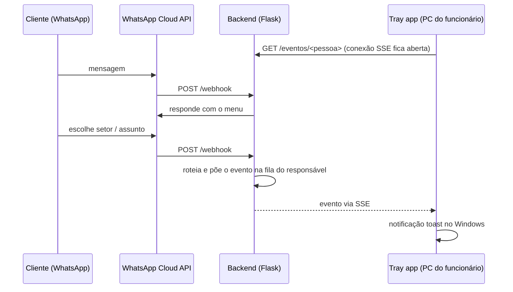

# FAMA Bot — Atendimento automatizado via WhatsApp

Chatbot de WhatsApp que faz a triagem dos clientes de um escritório de contabilidade (FAMA). O cliente escolhe o assunto num menu, e o funcionário responsável recebe na hora uma notificação nativa do Windows, enviada por um app leve que fica na bandeja do sistema (system tray).

## Como funciona



1. O cliente manda mensagem e navega por um menu: **Contábil, Fiscal, RH, Administrativo, Dúvidas**.
2. O backend recebe tudo por **webhook**, sem polling, e decide quem é o responsável.
3. O evento entra numa **fila por pessoa**.
4. O tray do funcionário fica conectado ao backend por **SSE** e mostra a notificação assim que o evento chega.

Quem abre a conexão é sempre o tray. Assim, os PCs do escritório não precisam de servidor, IP fixo ou porta aberta no firewall.

## Principais decisões

Resumo abaixo. O detalhamento, com as alternativas descartadas, está em [docs/decisoes.md](docs/decisoes.md).

| Decisão | Motivo |
|---|---|
| Webhook em vez de polling | menor latência, sem gastar recurso à toa, sem falha silenciosa |
| SSE em vez de WebSocket | a comunicação é só backend → tray; SSE é HTTP comum, mais simples e passa por proxy/firewall sem configuração extra |
| Tray nativo (`pystray` + `winotify`) | as máquinas do escritório são fracas: nada de navegador aberto ou Electron |
| Uma fila por pessoa | cada funcionário recebe só o que é dele |
| Um venv por componente | o `.exe` do tray (PyInstaller) não carrega Flask e afins |

## Stack

- **Backend:** Python, Flask, WhatsApp Cloud API (Meta)
- **Tray app:** Python, `pystray`, `winotify`, Tkinter (configuração)
- **Testes:** pytest
- **Dev local:** ngrok para expor o webhook
- **Deploy (planejado):** Docker para o backend, PyInstaller para o tray

## Estrutura

```
backend/     # Flask: webhook, menu, filas, SSE
tray_app/    # app de bandeja (Windows)
tests/       # testes do backend e do tray
docs/        # decisões e diagramas
```

## Rodando localmente

Requer **Python 3.13+** no Windows. Cada componente tem o próprio ambiente virtual:

```powershell
# Tray app
cd tray_app
python -m venv .venv
.\.venv\Scripts\Activate.ps1
pip install -r requirements.txt

# Backend
cd ..\backend
python -m venv .venv
.\.venv\Scripts\Activate.ps1
pip install -r requirements.txt
copy .env.example .env   # e preencha as chaves
```

> Se o PowerShell bloquear o `Activate.ps1`, rode uma vez: `Set-ExecutionPolicy -Scope CurrentUser RemoteSigned`.

## Privacidade

O repositório é público. Tokens ficam só no `.env`, e o mapeamento real setor → funcionário → contato fica num arquivo local fora do Git. Os arquivos `.example` e os testes usam só dados fictícios, e o conteúdo das mensagens dos clientes não é registrado em log.

## Status

🚧 **Em desenvolvimento.**

- ✅ Tray app: ícone, menu e notificações toast
- ✅ Estrutura do repositório e ambientes
- ⏳ Backend Flask e webhook do WhatsApp
- ⏳ Menu, filas por pessoa e SSE
- ⏳ Empacotamento e deploy

O passo a passo detalhado está em [tasklist.md](tasklist.md).
